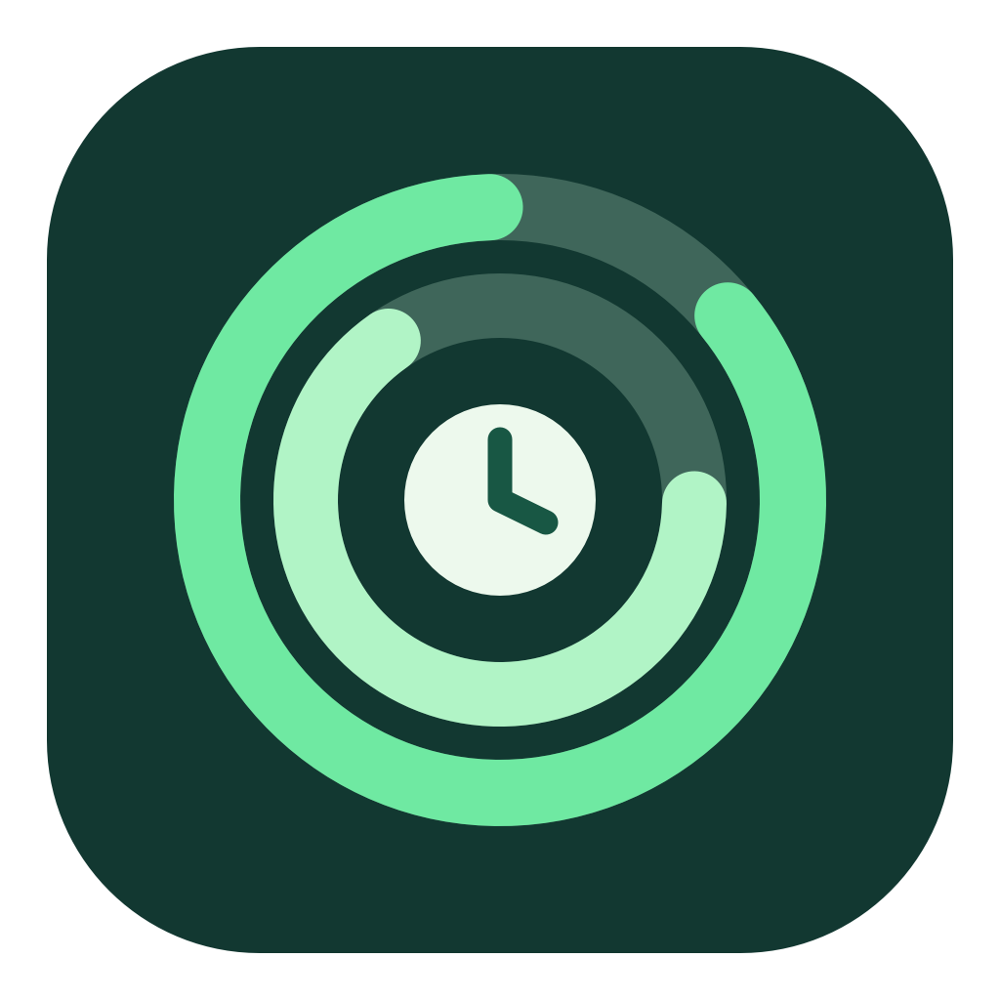

# Codex Usage Bar



An unofficial macOS utility that displays your remaining Codex quota at the top center of the primary display. It shows a five-hour percentage and reset time, followed by a weekly percentage and reset time. The current interface uses Chinese labels.

The green percentages show the remaining quota for the five-hour and weekly windows. Click the text to refresh immediately or quit. The app refreshes every minute. If the service is temporarily unavailable, it marks the last successful values with `~` until their respective reset times.

## Requirements

- macOS 13 or later.
- An executable Codex CLI at `/Applications/ChatGPT.app/Contents/Resources/codex-cli/bin/codex`.
- A local Codex CLI session that can read account rate limits.

The app calls the local Codex CLI's `account/rateLimits/read` method. This interface may change with Codex updates.

## Build from source

Use Xcode 16 or a compatible version. Run these commands from the repository root:

```sh
xcodebuild -project CodexUsageBar.xcodeproj -scheme CodexUsageBar -configuration Release -derivedDataPath build CODE_SIGNING_ALLOWED=NO build
codesign --force --deep --sign - build/Build/Products/Release/CodexUsageBar.app
```

The resulting app is at `build/Build/Products/Release/CodexUsageBar.app`. Copy it to `/Applications`, then open it from Finder.

The downloadable app archive contains Intel and Apple Silicon binaries. It has an ad hoc signature and is not notarized by Apple. Build from this repository if you prefer to inspect or modify the app yourself.

## Start at login

Copy `LaunchAgents/local.codex.usagebar.login.plist` to `~/Library/LaunchAgents/`, then sign out and back in to macOS. The configuration points to `/Applications/CodexUsageBar.app`. Choosing Quit from the menu bar text ends only the current run.

## Privacy and data

The app contains no embedded tokens, account details, or analytics service and does not log credentials. It launches the local Codex CLI, which uses your existing sign-in to obtain quota data. The app caches only the last successfully read percentages, reset times, and read time in the current user's app preferences so it can show marked stale values during a temporary service failure.

This project is not affiliated with OpenAI and is not an official Codex app.

## License

MIT. See [LICENSE](LICENSE).
